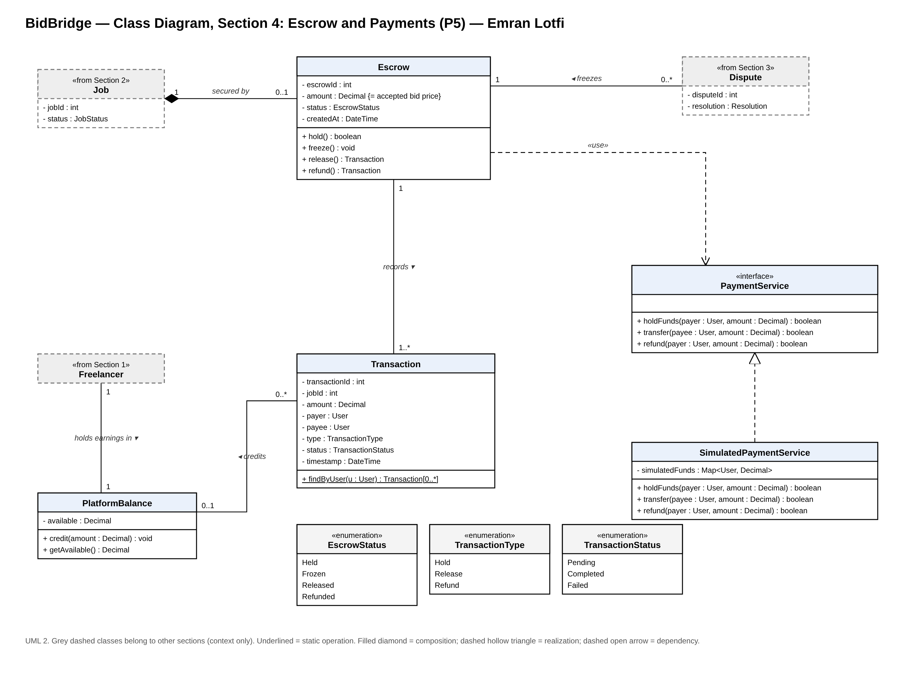

# BidBridge — Section 4: Escrow and Payments (P5)

**Contributor:** Emran Lotfi (b00100760)

## Exercise 1: Individual Class Inventory

| Class ID | Class Name | Purpose/Responsibility | Related Use Case(s) | Contributor |
|---|---|---|---|---|
| S4-C01 | Escrow | Holds the accepted bid amount for one job from bid acceptance until the work is approved or a dispute is settled. Controls the Held, Frozen, Released and Refunded states, and cannot be released while Frozen. | UC-01, UC-04, UC-05 | Emran Lotfi |
| S4-C02 | Transaction | Permanent record of every money movement (hold, release, refund) with job ID, amount, payer, payee, type, status and timestamp. Source of each user's transaction history (D5 Transactions). | UC-04, UC-05, UC-15 | Emran Lotfi |
| S4-C03 | PaymentService «interface» | Interface that all money movement goes through (hold, transfer, refund). Represents the Payment / Escrow Service in the DFD and keeps payment logic isolated (NFR-05). | UC-01, UC-04, UC-05 | Emran Lotfi |
| S4-C04 | SimulatedPaymentService | Prototype implementation of PaymentService, since the project scope uses a simulated escrow instead of real banking. | UC-01, UC-04, UC-05 | Emran Lotfi |
| S4-C05 | PlatformBalance | Stores a freelancer's earnings, credited when an escrow is released (FR-04). | UC-04, UC-15 | Emran Lotfi |

Supporting enumerations: `EscrowStatus` (Held, Frozen, Released, Refunded), `TransactionType` (Hold, Release, Refund), `TransactionStatus` (Pending, Completed, Failed).

## Class Selection Justification

These classes represent the main objects needed for P5 (Handle Escrow Payments) in BidBridge. `Escrow` holds the accepted bid amount for one job and controls its Held, Frozen, Released and Refunded states. `Transaction` is a separate class because every money movement must be recorded permanently with its payer, payee, type and time (D5 Transactions, FR-20). `PaymentService` is an interface, with `SimulatedPaymentService` as the prototype implementation, so the simulated escrow can later be replaced by a real provider without changing the other sections (NFR-05). `PlatformBalance` stores a freelancer's earnings so payment data stays out of the shared `Freelancer` class. `Job`, `Dispute` and `Freelancer` are shared classes from the other sections and appear in the diagram only to show where the escrow connects to them.

## Exercise 2: UML Class Diagram

Editable source: `Section4_Emran_UML.drawio`

## Associations and Multiplicities

| Association | Multiplicity | Explanation |
|---|---|---|
| Job — Escrow | 1 to 0..1 | Composition: a job is secured by at most one escrow, created when a bid is accepted. The escrow cannot exist without its job. |
| Escrow — Transaction | 1 to 1..* | Every escrow records at least its Hold transaction, later followed by a Release or a Refund. |
| Dispute — Escrow | 0..* to 1 | Opening a dispute freezes the job's escrow. Each dispute freezes one escrow, and an escrow can be frozen by several disputes over time. |
| Freelancer — PlatformBalance | 1 to 1 | Each freelancer holds their earnings in exactly one platform balance. |
| Transaction — PlatformBalance | 0..* to 0..1 | A Release transaction credits one freelancer's balance; Hold and Refund transactions credit none. |
| Escrow — PaymentService | «use» dependency | Escrow moves all money through the PaymentService interface instead of a specific provider (NFR-05). |
| SimulatedPaymentService — PaymentService | Realization | The prototype implements the PaymentService interface; a real payment provider can replace it later. |
