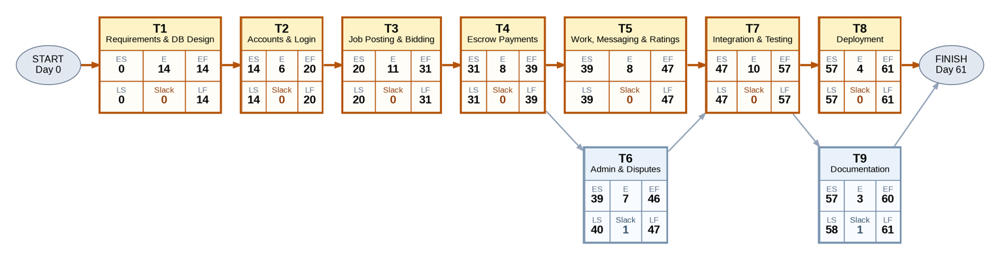

# BidBridge — Task-on-Node Network Schedule

| Task | E (days) | ES | EF | LS | LF | Slack |
| --- | --- | --- | --- | --- | --- | --- |
| T1 | 14 | 0 | 14 | 0 | 14 | 0 |
| T2 | 6 | 14 | 20 | 14 | 20 | 0 |
| T3 | 11 | 20 | 31 | 20 | 31 | 0 |
| T4 | 8 | 31 | 39 | 31 | 39 | 0 |
| T5 | 8 | 39 | 47 | 39 | 47 | 0 |
| T6 | 7 | 39 | 46 | 40 | 47 | 1 |
| T7 | 10 | 47 | 57 | 47 | 57 | 0 |
| T8 | 4 | 57 | 61 | 57 | 61 | 0 |
| T9 | 3 | 57 | 60 | 58 | 61 | 1 |

## Forward pass
ES = maximum EF of immediate predecessors (0 for T1); EF = ES + E.

- T1: ES = 0; EF = 0 + 14 = 14
- T2: ES = 14; EF = 14 + 6 = 20
- T3: ES = 20; EF = 20 + 11 = 31
- T4: ES = 31; EF = 31 + 8 = 39
- T5: ES = 39; EF = 39 + 8 = 47
- T6: ES = 39; EF = 39 + 7 = 46
- T7: ES = max(47, 46) = 47; EF = 47 + 10 = 57
- T8: ES = 57; EF = 57 + 4 = 61
- T9: ES = 57; EF = 57 + 3 = 60
- Project completion = max(61, 60) = 61 days

## Backward pass
For finishing tasks LF = 61; otherwise LF = minimum LS of immediate successors; LS = LF − E.

- T8: LF = 61; LS = 61 − 4 = 57
- T9: LF = 61; LS = 61 − 3 = 58
- T7: LF = min(57, 58) = 57; LS = 57 − 10 = 47
- T5: LF = 47; LS = 47 − 8 = 39
- T6: LF = 47; LS = 47 − 7 = 40
- T4: LF = min(39, 40) = 39; LS = 39 − 8 = 31
- T3: LF = 31; LS = 31 − 11 = 20
- T2: LF = 20; LS = 20 − 6 = 14
- T1: LF = 14; LS = 14 − 14 = 0

Slack = LS − ES = LF − EF. All critical tasks have 0 days; T6 and T9 have 1 day.
